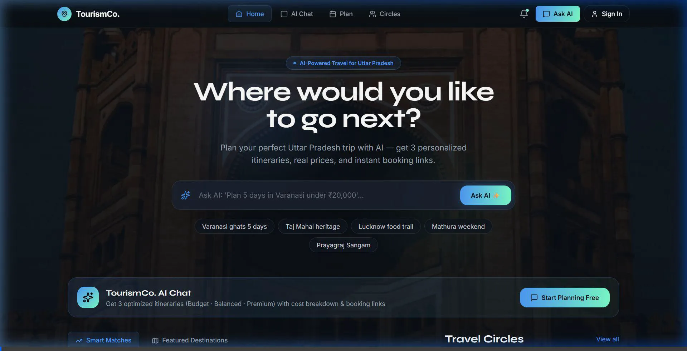
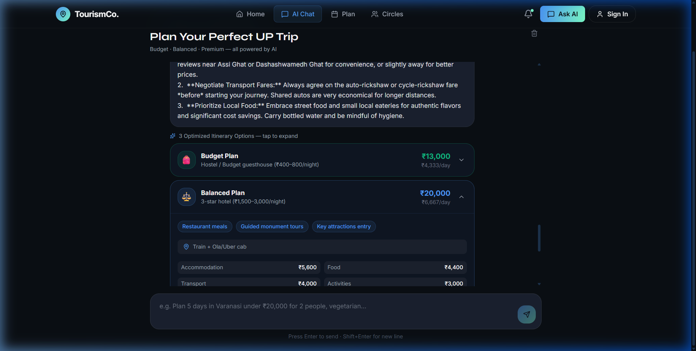

<div align="center">
  
  <h1>✈️ TourismCo. AI</h1>
  <p><strong>The Intelligent, AI-Powered Travel OS for Uttar Pradesh</strong></p>

  [](#)
  [](#)
  [](#)
  [](#)
  [](#)

  <p align="center">
    <a href="#-overview">Overview</a> •
    <a href="#-demo">Demo</a> •
    <a href="#-core-features">Features</a> •
    <a href="#-ai--rag-architecture">Architecture</a> •
    <a href="#-getting-started">Getting Started</a>
  </p>
</div>

<br/>

## 📖 Overview

**TourismCo. AI** is a premium, next-generation travel planning platform designed to modernize tourism in **Uttar Pradesh, India**. Moving beyond generic LLM chatbots, TourismCo employs a custom **Retrieval-Augmented Generation (RAG)** pipeline powered by the **Google Gemini 1.5 Flash** model and official UP Tourism data.

Whether you're planning a spiritual journey to Varanasi or a heritage tour in Agra, the platform dynamically generates highly accurate, budget-optimized, day-by-day itineraries that are tailored to your exact constraints (budget, days, group size, and dietary preferences).

---

## 🎥 Demo & Intelligent Itinerary Generation

Experience how our AI seamlessly parses complex constraints (e.g., *"Plan 3 days in Varanasi for my family under ₹20,000"*) to build multi-tiered itineraries.

### 1. Dynamic Plan Generation
The AI generates three optimized options (Budget, Balanced, Premium) with full cost breakdowns.


### 2. Day-by-Day Scheduling
Interactive, tabbed UI breaking down morning, afternoon, and evening activities, including hidden gems.


---

## ✨ Core Features

- 🧠 **Robust AI Engine:** Driven by Google Gemini with an enterprise-grade 7-model fallback chain and exponential backoff retry logic to ensure 99.9% uptime and API rate-limit resilience.
- 🗺️ **RAG-Powered Accuracy:** Eliminates hallucinations by anchoring AI responses in a verified JSON Knowledge Base (`upTourismKB.js`) built on official Govt. of India Survey Data.
- 🧮 **Granular Cost Calculation:** Dynamically calculates realistic budget breakdowns (Accommodation, Transport, Food, Activities) based on real-world expenditure patterns.
- 🎨 **Premium Glassmorphic UI:** A stunning, highly responsive frontend built with React, Vite, and Tailwind CSS.
- 📱 **Real-time Travel Circles:** Plan trips collaboratively with friends using Socket.IO powered group chats.

---

## 🧠 AI & RAG Architecture

Our backend relies on a custom implementation of RAG to ensure high-fidelity responses:

1. **Constraint Extraction:** Natural language processing parses specific constraints (Cities, Days, Budget, Travelers, Vegetarian, etc.).
2. **Local KB Retrieval (Vector-Free):** Fast, semantic keyword scoring matches the query against our local, hard-coded travel data structure.
3. **Gemini Reasoning:** The combined prompt (User Query + Extracted Constraints + Local Data + Web Search) is sent to Gemini for deep reasoning and itinerary structuring.
4. **Resilient Fallback:** If the active Gemini model encounters a `429` or `503` error, our system automatically falls back through a 7-model chain before degrading to a smart offline heuristic.

---

## 🛠️ Tech Stack

### Frontend Client
- **Framework:** React 19 (via Vite)
- **Styling:** Tailwind CSS + Autoprefixer
- **Icons & UI:** Lucide React
- **Routing:** React Router v7

### Backend Server
- **Runtime:** Node.js (v20+)
- **Framework:** Express.js
- **AI Integration:** Google Gemini API
- **Real-time:** Socket.IO
- **Security:** Helmet, CORS, Express Rate Limit

---

## 🚀 Getting Started

### Prerequisites
- [Node.js](https://nodejs.org/) (v18+)
- A [Google Gemini API Key](https://aistudio.google.com/app/apikey)

### 1. Clone & Install
```bash
git clone https://github.com/Ma-nas/TourismCo.git
cd TourismCo
```

### 2. Backend Setup
```bash
cd server
npm install

# Configure Environment
echo "PORT=5000" > .env
echo "GEMINI_API_KEY=your_api_key_here" >> .env

# Start Development Server (Runs on :5000)
npm run dev
```

### 3. Frontend Setup
```bash
# Open a new terminal in the root directory
npm install

# Configure Environment
echo "VITE_API_URL=http://localhost:5000" > .env.development

# Start Vite Client (Runs on :5173)
npm run dev
```

---

## 🌍 Deployment

TourismCo is designed for seamless, stateless deployment:
- **Frontend:** Pre-configured for seamless deployment on [Vercel](https://vercel.com/) or [Netlify](https://www.netlify.com/).
- **Backend:** Easily hostable on [Render](https://render.com/), [Railway](https://railway.app/), or AWS.

---

## 📜 License
This project is licensed under the MIT License - see the [LICENSE](LICENSE) file for details.

<div align="center">
  <p>Built with ❤️ for Uttar Pradesh Tourism</p>
</div>
